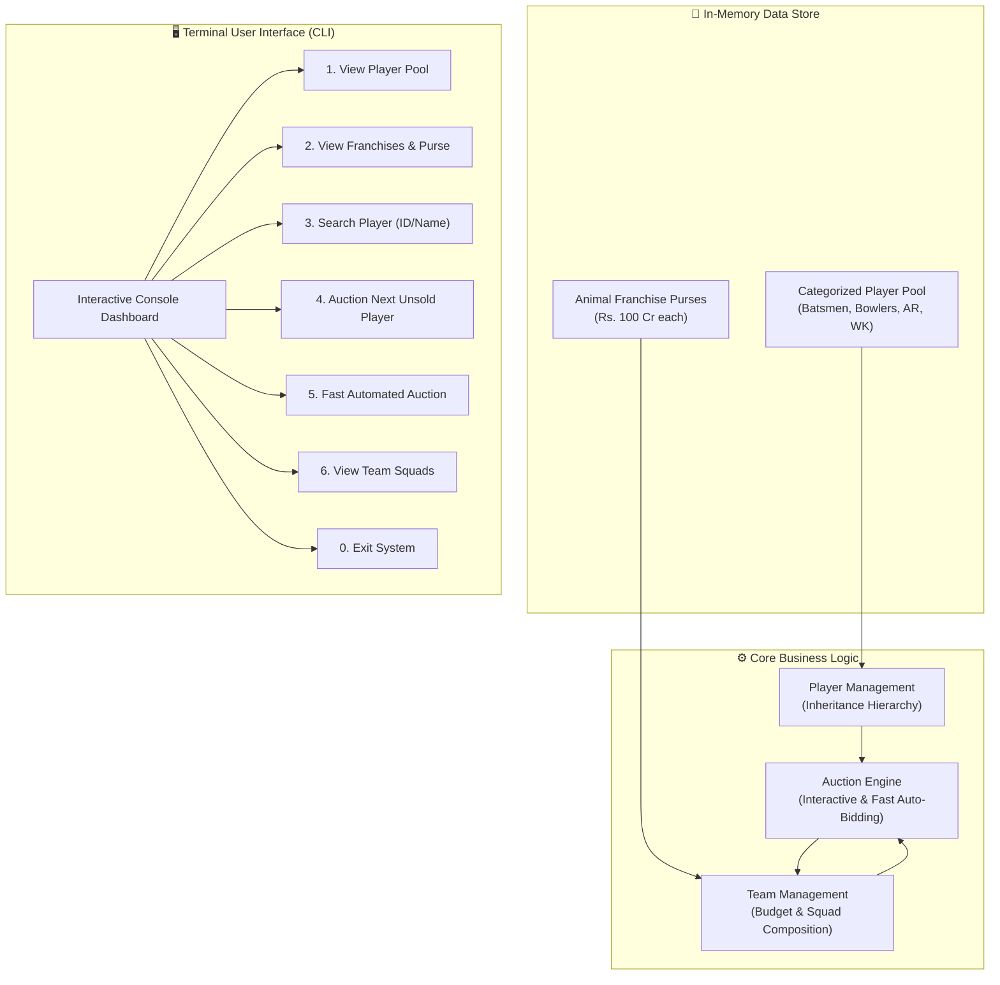
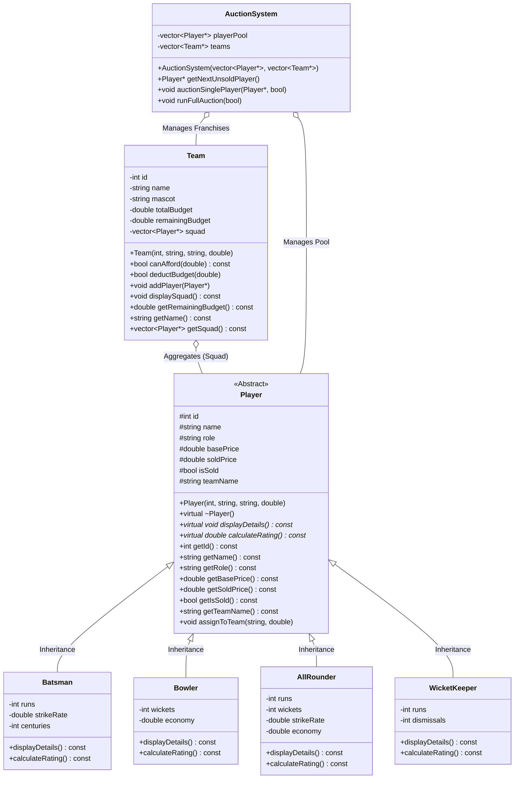
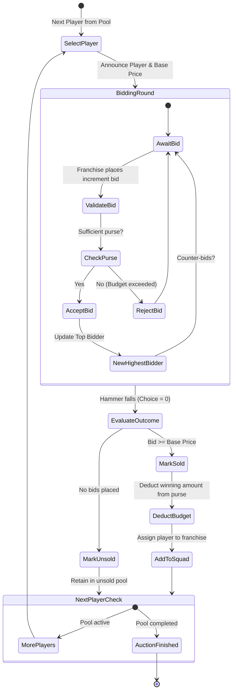

# 🏏 Sports Player Auction Management System (IPL-Style)
> **An Object-Oriented Console Application in C++**

---

## 📌 Project Overview

The **Sports Player Auction Management System** is an object-oriented software application inspired by the Indian Premier League (IPL) mega-auction mechanism. It models four animal-themed franchises, each initialized with a fixed purse of **Rs. 100 Crore**, competing to acquire specialized cricket players (Batsmen, Bowlers, All-Rounders, and Wicket-Keepers) through interactive bidding wars.

---

## 🦁 Animal-Themed Franchises & Budget Setup

| Franchise Name | Mascot / Animal | Initial Purse / Budget | Max Squad Target |
| :--- | :---: | :---: | :---: |
| **Roaring Lions** | 🦁 Lion | Rs. 100.00 Crore | 5-6 Players |
| **Fierce Tigers** | 🐯 Tiger | Rs. 100.00 Crore | 5-6 Players |
| **Mighty Elephants** | 🐘 Elephant | Rs. 100.00 Crore | 5-6 Players |
| **Swift Falcons** | 🦅 Falcon | Rs. 100.00 Crore | 5-6 Players |

---

## 🎭 Hypothetical Player Pool Preview

Players are categorized into 4 core cricketing specializations, each with distinct attributes and base prices:

```
[Batsman]        Aarav Stone     | Base: Rs. 2.00 Cr | Runs: 3850, Strike Rate: 142.5, 100s: 4
[Bowler]         Shadow Bolt     | Base: Rs. 2.00 Cr | Wickets: 95, Economy: 7.15
[All-Rounder]    Blaze Rivera    | Base: Rs. 2.00 Cr | Runs: 2400, Wickets: 68, Bat SR: 141.0
[Wicket-Keeper]  Dexter Fox      | Base: Rs. 1.50 Cr | Runs: 2750, Dismissals: 56
```

---

## 🏛️ Comprehensive OOPS Mapping (Viva Ready)

| OOP Concept | Project Implementation Detail | Practical Code Example |
| :--- | :--- | :--- |
| **1. Abstraction** | An abstract base class `Player` enforces a uniform contract via pure virtual functions (`= 0`). | `virtual void displayDetails() const = 0;`<br>`virtual double calculateRating() const = 0;` |
| **2. Encapsulation** | Sensitive data (`remainingBudget`, `soldPrice`, `squad`) is `private`/`protected`. Mutated strictly via validated methods. | `bool Team::deductBudget(double amount)` prevents overspending. |
| **3. Inheritance** | `Player` is the generalized base class. Specialized subclasses (`Batsman`, `Bowler`, `AllRounder`, `WicketKeeper`) inherit common properties and introduce role-specific attributes. | `class Batsman : public Player`<br>`class Bowler : public Player` |
| **4. Polymorphism (Runtime)** | Overriding base class methods in derived classes. Storing derived objects in base pointers `vector<Player*> squad`. | `player->displayDetails();`<br>`player->calculateRating();` (Dynamic dispatch via V-Table) |
| **5. Polymorphism (Compile-time)** | Function overloading for player searches by ID or Name. | `findPlayer(pool, int id)` vs `findPlayer(pool, string name)` |
| **6. Composition & Aggregation** | `Team` aggregates a collection of `Player*` pointers. | `std::vector<Player*> squad;` |
| **7. Resource Management** | Virtual destructor in `Player` guarantees clean polymorphic object deletion. | `virtual ~Player() {}` |

---

## 📊 System Architecture & Data Flow



---

## 🧩 Class Hierarchy & Relationship Diagram



---

## ⚡ Auction Engine Logic & State Machine



---

## 📂 Project Directory Structure

```
IOOP project/
│
├── README.md                  # Complete architecture, diagrams & viva documentation
├── .gitignore                 # Ignores compiled binaries (*.exe, *.o)
└── main.cpp                   # Clean, self-contained C++ implementation
```

---

## 🚀 How to Compile & Run

```bash
# Compile using any standard C++ compiler
g++ main.cpp -o main.exe

# Run the executable
.\main.exe
```

---

## 🎓 Viva Questions & Answers Cheat-Sheet

1. **Q: Why is `Player` an abstract class?**
   - **A**: A player in cricket always plays a specialized role (Batsman, Bowler, etc.). Declaring pure virtual functions (`displayDetails() = 0` and `calculateRating() = 0`) turns `Player` into an abstract class, preventing accidental instantiation and ensuring each role provides its specific implementation.

2. **Q: Where is runtime polymorphism demonstrated?**
   - **A**: `Team` stores players as a collection of base pointers: `std::vector<Player*> squad`. When we loop over `squad` and call `squad[i]->displayDetails()`, C++ uses the V-Table pointer (`vptr`) to dynamically invoke the derived class method at runtime.

3. **Q: Why does `Player` have a virtual destructor?**
   - **A**: When deleting derived objects via base class pointers (`delete player;`), a virtual destructor guarantees the complete destructor chain is called, avoiding memory leaks.

4. **Q: How does the system demonstrate Encapsulation?**
   - **A**: Critical team data (`remainingBudget`, `squad`) is `private`. The purse can only be reduced through `deductBudget()`, which checks `canAfford()` to prevent overspending.

5. **Q: Where is function overloading used?**
   - **A**: We overloaded `findPlayer`:
     - `Player* findPlayer(const vector<Player*>& pool, int id);`
     - `Player* findPlayer(const vector<Player*>& pool, string name);`
     Both share the same function name but take different argument types.
