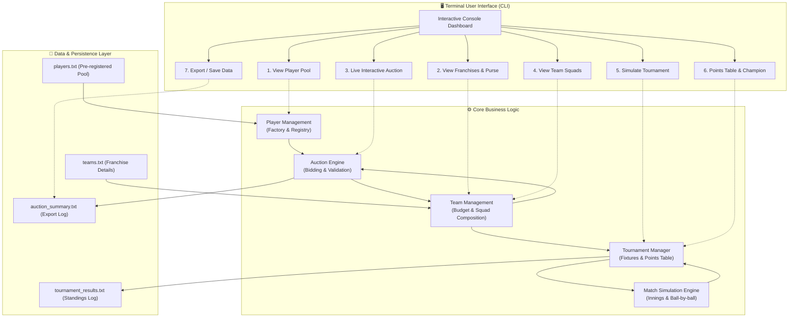
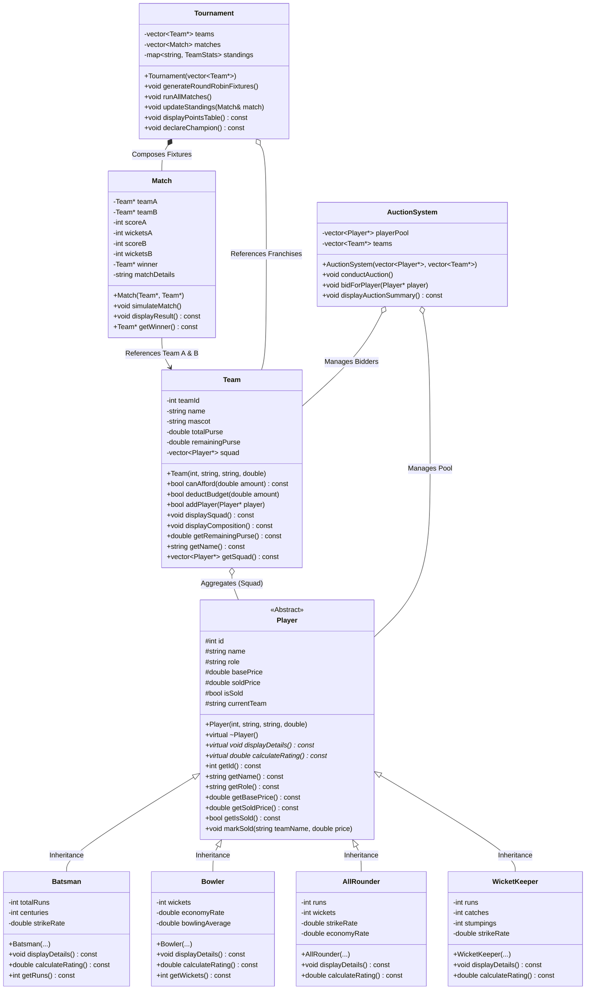
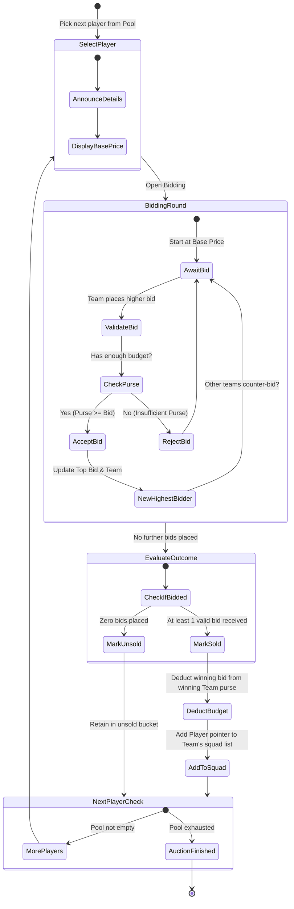
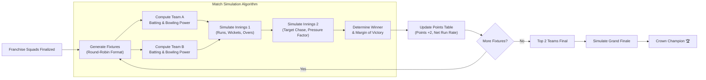
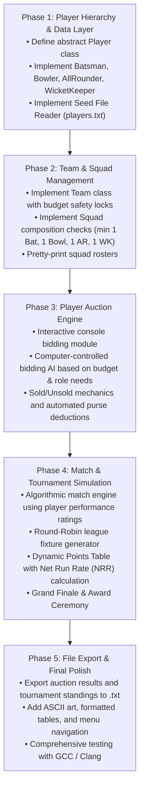

<<<<<<< HEAD
# IOOP Project

This repository contains our Object Oriented Programming project.
=======
# 🏏 Sports Tournament & Player Auction Management System (IPL-Style)
> **A Comprehensive, Object-Oriented Console Application in C++**

---

## 📌 Executive Summary

The **Sports Tournament & Player Auction Management System** is a software application developed in modern, standard C++. Inspired by the Indian Premier League (IPL) mega-auction and tournament structure, it models a real-world sports franchise ecosystem. 

The system operates across three primary phases:
1. **Pre-Auction Setup**: Loading animal-themed franchises, fixed budgets, and categorized fictional player pools.
2. **Interactive Live Auction**: Real-time bidding system with live budget deductions, role validation, and sold/unsold tracking.
3. **Tournament & Match Simulation**: Round-robin league fixtures, simulated cricket matches calculated via player performance ratings, dynamic points table generation (Net Run Rate, Points), and championship playoffs.

---

## 🦁 Animal-Themed Franchises & Budget Setup

Each franchise is themed around animals, representing power, speed, agility, and dominance.

| Franchise Name | Mascot / Icon | Initial Purse / Budget | Max Squad Size | Home Ground |
| :--- | :---: | :---: | :---: | :---: |
| **Roaring Lions** | 🦁 Lion | ₹100.00 Crore | 6 Players | Den Arena |
| **Fierce Tigers** | 🐯 Tiger | ₹100.00 Crore | 6 Players | Bengal Fortress |
| **Mighty Elephants** | 🐘 Elephant | ₹100.00 Crore | 6 Players | Tusker Colosseum |
| **Swift Falcons** | 🦅 Falcon | ₹100.00 Crore | 6 Players | Falcon Nest |

---

## 🎭 Hypothetical Player Pool Preview

Players are categorized into 4 core cricketing specializations, each with distinct attributes and base prices:

```
[Batsman]        Aarav "Blaster" Stone   | Base: ₹2.00 Cr | Runs: 4200, Strike Rate: 145.2, 100s: 4
[Bowler]         Shadow "Yorker" Bolt    | Base: ₹1.50 Cr | Wickets: 110, Economy: 7.20, Bowling Avg: 21.4
[All-Rounder]    Blaze "Dynamo" Rivera   | Base: ₹2.00 Cr | Runs: 2800, Wickets: 75, Bat SR: 138.0
[Wicket-Keeper]  Dexter "Gloves" Fox     | Base: ₹1.00 Cr | Runs: 3100, Catches: 58, Stumpings: 18
```

---

## 🏛️ Comprehensive OOPS Mapping (Viva Ready)

| OOP Concept | Project Implementation Detail | Practical Code Example |
| :--- | :--- | :--- |
| **1. Abstraction** | An abstract base class `Player` hides complex calculations and enforces a uniform contract via pure virtual functions. | `virtual void displayDetails() const = 0;`<br>`virtual double calculateRating() const = 0;` |
| **2. Encapsulation** | Strict data hiding. Data members (`remainingBudget`, `basePrice`, `soldPrice`, `squad`) are `private`/`protected`. Mutated strictly via validated setters. | `bool Team::deductBudget(double amount)` ensures a team cannot spend more than their remaining purse. |
| **3. Inheritance** | `Player` is the generalized base class. Specialized subclasses (`Batsman`, `Bowler`, `AllRounder`, `WicketKeeper`) inherit common properties and introduce role-specific attributes. | `class Batsman : public Player`<br>`class Bowler : public Player` |
| **4. Polymorphism (Runtime)** | Overriding base class methods in derived classes. Manipulating derived player instances through a collection of base pointers `vector<Player*>`. | `player->displayDetails();`<br>`player->calculateRating();` (Dynamic dispatch via V-Table) |
| **5. Polymorphism (Compile-time)** | Function and method overloading for flexible data access and searching. | `findPlayer(int id)` vs `findPlayer(const string& name)` |
| **6. Composition & Aggregation** | `Team` aggregates a collection of `Player*`. `Match` aggregates two `Team*` references. `Tournament` is composed of `Team`s, `Match`es, and a `PointsTable`. | `std::vector<Player*> squad;`<br>`std::vector<Match> fixtures;` |
| **7. Resource Management** | Virtual destructors in polymorphic hierarchies prevent memory leaks when deleting derived objects through base class pointers. | `virtual ~Player() {}` |
| **8. File Handling** | Persistent storage using C++ `<fstream>` for loading rosters and writing auction summaries and tournament standings. | `ifstream inFile("players.txt");`<br>`ofstream outFile("auction_summary.txt");` |

---

## 📊 System Architecture & Data Flow



---

## 🧩 Class Hierarchy & Relationship Diagram



---

## ⚡ Auction Engine Logic & State Machine



---

## 🏆 Match & Tournament Simulation Pipeline



---

## 📂 Modular Project Directory Structure

To ensure clean code separation, easy compilation, and strict modularity, the project will be organized as follows:

```
IOOP project/
│
├── README.md                  # Complete architecture, diagrams & documentation
├── Makefile                   # Multi-platform build file (g++ / clang++)
│
├── data/                      # Persistent storage / data files
│   ├── players.txt            # Seed file containing categorized players & stats
│   ├── teams.txt              # Seed file containing animal franchise details
│   ├── auction_summary.txt    # Generated auction report
│   └── tournament_results.txt # Generated tournament results & points table
│
├── include/                   # Header files (.h / .hpp)
│   ├── Player.h               # Abstract base class: Player
│   ├── Batsman.h              # Derived class: Batsman
│   ├── Bowler.h               # Derived class: Bowler
│   ├── AllRounder.h           # Derived class: AllRounder
│   ├── WicketKeeper.h         # Derived class: WicketKeeper
│   ├── Team.h                 # Franchise & Squad Management
│   ├── AuctionSystem.h        # Auction engine & Bidding algorithms
│   ├── Match.h                # Single match simulation logic
│   ├── Tournament.h           # Tournament fixtures, points table & playoffs
│   ├── FileManager.h          # File I/O utilities
│   └── UIHelper.h             # Console styling, tables & color formatting
│
└── src/                       # Implementation files (.cpp)
    ├── Player.cpp
    ├── Batsman.cpp
    ├── Bowler.cpp
    ├── AllRounder.cpp
    ├── WicketKeeper.cpp
    ├── Team.cpp
    ├── AuctionSystem.cpp
    ├── Match.cpp
    ├── Tournament.cpp
    ├── FileManager.cpp
    ├── UIHelper.cpp
    └── main.cpp               # Interactive CLI entry point with switch-case menu
```

> **Note on Compilation**: A unified single-file compile or standard multi-file compile will be supported:
> ```bash
> g++ -std=c++17 src/*.cpp -Iinclude -o CricketAuctionSim
> ./CricketAuctionSim
> ```

---

## 🗺️ Step-by-Step Implementation Roadmap



---

## 🎓 Viva Questions & Answers Cheat-Sheet

Here are typical viva questions examiners ask for this exact system and how our design answers them:

1. **Q: Why is `Player` an abstract class?**
   - **A**: A real-world cricketer is never just a generic "Player" without a specific role. `Player` defines pure virtual functions (`displayDetails() = 0` and `calculateRating() = 0`), which forces derived classes (`Batsman`, `Bowler`, etc.) to provide role-specific implementations. It also prevents accidental instantiation of a generic player object.

2. **Q: Where is runtime polymorphism demonstrated?**
   - **A**: The `Team` stores players as a collection of base pointers `std::vector<Player*> squad`. When we loop through the squad and invoke `player->displayDetails()`, C++ uses the V-Table pointer (`vptr`) to resolve and execute the appropriate derived class function at runtime.

3. **Q: Why is the destructor in `Player` marked `virtual`?**
   - **A**: When a derived object (e.g. `Batsman`) is deleted via a base class pointer (`Player*`), a non-virtual destructor would result in undefined behavior and memory leaks because only the base destructor would be invoked. A `virtual ~Player()` guarantees the complete destructor chain is called.

4. **Q: How does the system enforce Encapsulation?**
   - **A**: Critical financial data such as `remainingPurse` cannot be directly modified from outside the `Team` class. It can only be reduced via `deductBudget(amount)`, which includes rigorous validation to ensure the bid does not exceed the available purse or break minimum squad requirements.

5. **Q: How does the match simulation work?**
   - **A**: Each player computes a normalized rating via `calculateRating()`. The match simulator computes the aggregate batting strength and bowling strength of both playing elevens, incorporating simulated pitch conditions and controlled random variance to realistically model cricket scores.

---

## 🚦 Ready for Your Approval!

Once you review and approve this architecture, roadmap, and design, we will proceed immediately with the clean, robust C++ implementation!
>>>>>>> ed85d8a (This is readme update pls check it and give approval)
